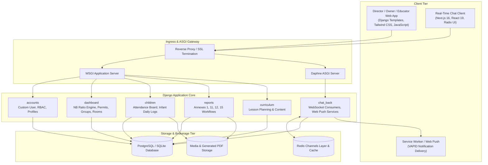
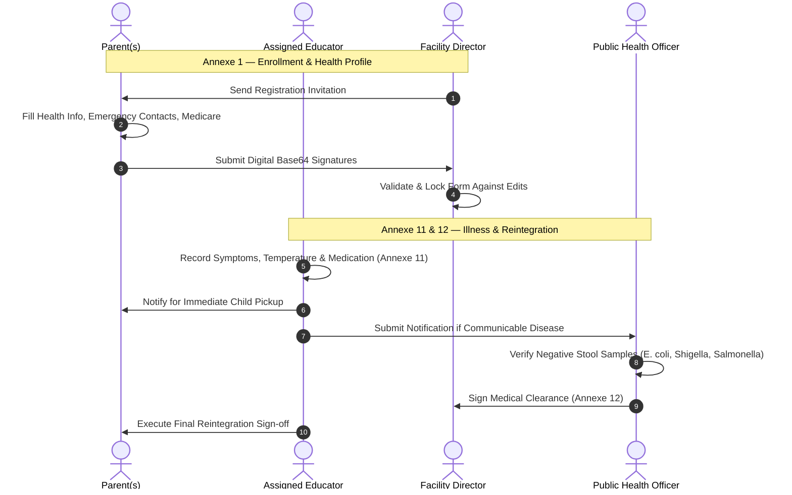

# GarderieNova (GNV)

**Enterprise Educational Daycare Management & Regulatory Compliance Platform**  
*Tailored for New Brunswick (Canada) Daycare Regulations • Multi-Tenant Architecture • Real-Time WebSockets • Bilingual Support (FR/EN)*

[](https://www.python.org/)
[](https://www.djangoproject.com/)
[](https://nextjs.org/)
[](https://react.dev/)
[](https://www.typescriptlang.org/)
[](https://tailwindcss.com/)
[](https://redis.io/)
[](https://www.postgresql.org/)
[](https://channels.readthedocs.io/)
[](https://weasyprint.org/)
[](#)

---

## 1. Project Overview

GarderieNova is an enterprise administrative and operational platform engineered specifically for licensed early childhood education facilities (*garderies éducatives*) operating under the legal jurisdiction of the **Province of New Brunswick, Canada**.

The system automates the statutory requirements codified by the **Early Childhood Services Act / Loi sur les services de garde éducatifs du Nouveau-Brunswick**, preventing human calculation error in legal educator-to-child staffing ratios, digitizing mandatory government health and safety forms (Annexes 1, 10, 11, 12, and 15), securing child profiles with dual-custody digital signatures, and providing a real-time event-driven communications hub connecting administrative leadership, educators, and families.

---

## 2. System Architecture

The platform uses a hybrid architectural model combining server-rendered mission-critical administrative flows with an asynchronous real-time micro-frontend:

1. **Administrative Core (Django 5 + Tailwind CSS):** Server-rendered templates for stateful multi-step government workflows, complex relational permissions, and administrative dashboards.
2. **Real-Time Asynchronous Engine (Daphne + Django Channels + Redis):** Event-driven ASGI gateway powering WebSockets for real-time ratio updates, chat channels, and attendance telemetry.
3. **Chat Subsystem (`chat-ui`):** Standalone Next.js 16 (React 19, TypeScript, Radix UI) client handling real-time messaging, browser voice recording via MediaRecorder API, and push notifications.



---

## 3. Comprehensive Feature Catalog

### 3.1. Multi-Tenant Organization & Facility Management
- **Hierarchical Facility Structure:** Supports enterprise networks managing multiple daycare facilities under an `Organization` $\to$ `Center` $\to$ `Room` $\to$ `Group` hierarchy.
- **Operating Permit Association:** Dedicated `CenterPermit` entity linking provincial operating licenses directly to daycare centers and cohorts.
- **Statutory Room Capacity Allocation:** Automated calculation of maximum room capacities based on intended age brackets (`infant`, `2y`, `3y`, `4y`, `5y+`).
- **Flexible Cohort Grouping:** Logical group tracking tied to rooms and operating permits for live ratio monitoring.
- **Temporary Child Transfers:** Mechanism to execute temporary reassignments of children between educators within the center while preserving audit trails.
- **Screen-Lock Protection:** Dedicated ratio board screen-lock toggle preventing accidental touch inputs on tablets during inspections.
- **Access Delegation:** Granular controls allowing facility directors to delegate attendance board access to senior educators.

### 3.2. Role-Based Access Control (RBAC) & Authentication
- **Custom User Model:** UUID-based primary keys with email authentication, activity timestamps, and online presence tracking.
- **Six Specialized Actor Roles:**
  - **Network Owner:** Global multi-center oversight, facility onboarding, director appointments, license compliance auditing.
  - **Director:** Full center governance, staff assignments, room allocations, waitlist admissions, transfer approvals, regulatory locking.
  - **Vice Director:** Assistant administration with configurable JSON-based granular permission sets.
  - **Principal Educator:** Center-wide pedagogical leadership, curriculum oversight, and educator ratio compliance audits.
  - **Educator:** Daily roll call, 5-day infant tracking sheets, lesson delivery, emergency roll call, illness/incident reporting.
  - **Parent:** Child profile registration, dual-parent digital signatures, real-time presence feed, voice messaging, incident reviews.
- **Security-Hardened Authentication:** Generic error responses for authentication attempts to prevent user enumeration attacks.

### 3.3. Statutory New Brunswick Ratio & Capacity Calculation Engine
- **Mathematical Cumulative Points Formula:** Enforces official New Brunswick Daycare Standards for mixed-age cohorts:
  $$\text{Total Points} = \sum_{i=1}^{N} \text{Weight}(\text{Age}_i)$$
  $$\text{Required Educators} = \left\lceil \frac{\text{Total Points}}{\text{Max Ceiling}} \right\rceil$$

| Age Bracket | Statutory Linear Ratio | Decimal Factor | Points per Child | Educator Point Ceiling |
| :--- | :---: | :---: | :---: | :---: |
| **Infant (<24 Months)** | 1 : 3 | `0.333` | 300 pts | **900 pts** |
| **2 Years Old** | 1 : 5 | `0.200` | 200 pts | **1,050 pts** |
| **3 Years Old** | 1 : 8 | `0.125` | 125 pts | **1,050 pts** |
| **4 Years Old** | 1 : 10 | `0.100` | 100 pts | **1,050 pts** |
| **School Age (5+ Years)** | 1 : 15 | `0.067` | 67 pts | **1,050 pts** |

- **Cumulative Mixed-Age Calculation (Ages 2–4):**
  $$\text{Total Points} = (N_{2} \times 200) + (N_{3} \times 125) + (N_{4} \times 100)$$
- **Strict Infant Segregation Enforcement:** Immediate violation flagged if children under 24 months are grouped with children aged 24 months or older (`has_under_24m and has_over_24m`).
- **Fractional Surplus Tolerance:** Required staffing increases only if the fractional surplus exceeds `0.05` points.
- **Dynamic Group Capacity Limit:**
  $$\text{Calculated Max Capacity} = \left\lfloor \frac{2.0}{\text{Highest Age Factor in Group}} \right\rfloor$$
- **Educator Compliance Validation:** Individual checks confirming each educator does not exceed the `1.05` maximum factor points threshold.

### 3.4. Child Enrollment & Health Profiles (Annexe 1)
- **Detailed Child Records:** Birth date tracking with real-time age decomposition (years, months, days), Medicare card number, and expiration date.
- **Health & Safety Documentation:** Primary care physician contact, severe and fatal allergies, Epipen requirements, continuous medications, routine critical care instructions (catheter, diabetes), and medical/cultural dietary restrictions.
- **Medical History & Immunization:** Infectious disease history flags, vaccination proof tracking, and statutory exemption documentation.
- **Developmental History:** Autonomy tracking (dressing, eating, toilet, hygiene, motor skills), transition recommendations, and personal interests.
- **Pickup & Custody Authorization:**
  - Verified authorized pickups (`AuthorizedPickup`).
  - Emergency backup contacts (`EmergencyContact`).
  - Legally unauthorized pickup restrictions list (`UnauthorizedContact`).
- **Dual-Parent Digital Signatures:** Base64 canvas signature capture for both parents with director lock controls and automatic historical versioning upon unlock.

### 3.5. Waitlist & Admissions Management
- **Age-Segmented Waitlists:** Pre-registration management with priority tags (siblings, special care requirements) and registration dates.
- **Automated Admission Notifications:** Instant notification delivery to parents when spots become available.
- **Cross-Center Auto-Removal:** Automatic removal from external center waitlists once a child is formally admitted to a facility.

### 3.6. Real-Time Attendance Tracking (Annexe 10)
- **Real-Time Roll Call:** Educator attendance board supporting Present, Absent, and Left statuses.
- **Time Validation:** Arrival and departure time logging with strict chronological validation.
- **Standardized Absence Reason Codes:** Mandates the 9 statutory New Brunswick absence classification codes:
  - Code 1: Diarrhée
  - Code 2: Fièvre
  - Code 3: Symptômes du rhume (toux, otite, mal de gorge, écoulement oculaire)
  - Code 4: Problèmes de peau
  - Code 5: Vomissement
  - Code 6: Changement de comportement sans aucun autre symptôme
  - Code 7: Autre maladie (with detailed notes)
  - Code 8: Absence non liée à une maladie
  - Code 9: Autre (with detailed notes)
- **Regulatory PDF Export:** Automated generation of the 5-day official attendance register.

### 3.7. Illness Reporting & Public Health Tracking (Annexe 11)
- **Symptom Logging:** Structured tracking of illness onset symptoms.
- **Vital Signs & Medication:** Body temperature recording, measurement timestamp, and medication administration records.
- **Public Health Escalation:** Tracking of mandatory communications with Public Health authorities and verification of reports within the preceding 24 hours.
- **Parent Notification & Early Departure:** Logging of parent contact timestamps and early departure times.
- **Digital Signatures:** Dual signature flow between the filing educator and the collecting parent.

### 3.8. Exclusion Reintegration Management (Annexe 12)
- **Readmission Protocols:** Tracks illness onset, professional diagnosis date, and treatment initiation date following exclusion.
- **General Clearance Signatures:** Formal readmission sign-offs by educator and parent.
- **Public Health Laboratory Clearance:** Verification of negative stool culture requirements for enteric pathogens (E. coli, Shigella, Salmonella typhi) with official Public Health representative signature.

### 3.9. Digital Incident Reporting (Annexe 15)
- **Three-Tier Signature Sequence:** Progressive digital signature flow (Educator $\to$ Parent $\to$ Director).
- **Audit-Locked PDF Generation:** PDF export and permanent archiving enabled only after all three required signatures are confirmed.

### 3.10. Inter-Center Child Transfers & Permanent Audit Ledger
- **Multi-Center Transfer Protocol:** Transfer request lifecycle supporting inter-facility mobility.
- **Dual Director Approvals:** Independent consent required from both outgoing and incoming facility directors.
- **Parent Consent Verification:** Multi-parent signature capture validating transfer terms.
- **Immutable Transfer History:** Permanent audit ledger (`TransferHistory`) preserving origin center, target center, approving directors, parent signatures, and rationale, independent of future center or record modifications.

### 3.11. Infant Daily Activity Telemetry (<24 Months)
- **Weekly 5-Day Grid Tracking:** Comprehensive daily logs for infants from Monday through Friday.
- **Nutrition & Hydration Tracking:** Meals, snacks, and bottle feedings with timestamps and consumption metrics (Rien, Peu, Presque tout, S.O.).
- **Sleep & Rest Schedules:** Start and end times for up to three separate daily naps.
- **Emotional & Behavioral Matrix:** Ten behavioral indicators (Content, Amusé, Affectueux, Exigeant, Pleurnicheur, Malheureux, Tranquille, Collant, Fatigué, Autre).
- **Diaper & Toilet Grid:** Timestamps, wet/dry checks, potty sitting, and stool consistency codes (N, M, A, S).
- **Educator Daily Signatures:** Daily digital sign-off and downloadable weekly PDF summaries.

### 3.12. Pedagogical Curriculum Planning
- **Centralized Lesson Plans:** Lesson creation interface supporting PDF documents, external video URLs (YouTube/Vimeo), and rich instructional text.
- **Educator Assignments:** Pedagogical directives assigned by Directors and Owners to designated educators.

### 3.13. Real-Time Chat & Communications Subsystem
- **Decoupled Next.js 16 Micro-Frontend:** Real-time messaging client powered by WebSockets, Daphne, and Redis.
- **Browser Audio Messaging:** Native voice message recording via MediaRecorder API with inline audio playback bubbles.
- **Media & Document Sharing:** Transmission of images, video files, and documents with preview rendering.
- **Focus-Aware Read Telemetry:** Message delivery indicators with focus-sensitive read status updates (messages marked read only when the active browser tab is focused).
- **Online Presence & Invitations:** User connection states, invitation handshakes, and user blocking/unblocking controls.
- **Web Push Notifications (VAPID):** Push notification delivery to desktop and mobile clients via `pywebpush`.

### 3.14. Center Community Social Feed
- **Targeted Broadcasts:** Publication of announcements, photos, videos, and events with scoped audience filters (All Parents, Specific Groups, Specific Parents).
- **Media Galleries:** Multi-asset image and video carousels.
- **Social Interactions:** Emoji reactions (Like, Love, Haha, Wow, Sad, Angry), threaded comment discussions, user mentions (`@user`), and parent post bookmarking.

### 3.15. Emergency Evacuation & Fire Drill Protocols
- **One-Touch Evacuation Manifest:** Instant generation of outdoor safety roll-call manifests based on real-time room occupancy.
- **Headcount Verification:** Point-by-point safety confirmation of each child present during emergency drills.
- **Safety Audit Archiving:** Automated recording of post-evacuation roll calls for regulatory fire safety compliance.

### 3.16. Client-Side State Resilience & Form Recovery
- **LocalStorage State Backup:** Continuous background caching of multi-step administrative form data.
- **Interruption Protection:** Automatic form state restoration following accidental browser closures or network interruptions.
- **Session Cleanup:** Secure clearance of cached data upon confirmed form submission.

### 3.17. Document Compilation Engine
- **Server-Side PDF Rendering:** WeasyPrint integration compiling HTML/CSS templates into print-ready regulatory PDFs.
- **Client-Side Document Export:** jsPDF integration for dynamic local client exports.

---

## 4. Regulatory Workflow Sequence



---

## 5. Database Schema & Data Models

The full entity-relationship structure is visualized in `DB_GNV.svg`.

### Primary Data Entities
- **`accounts.User`**: Base UUID user model with email authentication, role choices, and presence indicators.
- **`accounts.Owner` / `Director` / `ViceDirector` / `Educator` / `EducatorPrincipal` / `ParentProfile`**: Specialized role profile models.
- **`dashboard.Organization`**: Multi-center tenant entity holding enterprise ownership.
- **`dashboard.Center`**: Facility model storing address, permit identification, and Atlantic timezone configuration.
- **`dashboard.CenterPermit`**: Operating license entity linked to centers and educational groups.
- **`dashboard.Room`**: Facility physical space with age-bracket capacity baselines.
- **`dashboard.Group`**: Cohort entity executing real-time ratio calculations and compliance checks.
- **`dashboard.Child`**: Child record with birth dates, Medicare details, and medical attributes.
- **`dashboard.TransferRequest` & `TransferHistory`**: Inter-center transfer workflow and permanent audit ledger.
- **`dashboard.EvacuationDrill` & `EvacuationCheck`**: Emergency fire drill management and headcounts.
- **`children.Attendance`**: Daily roll-call entries with arrival/departure timestamps and regulatory absence codes.
- **`children.WeeklyChildReport` & `DailyActivityLog`**: 5-day infant tracking grid models.
- **`reports.EnrollmentForm`**: Digital Annexe 1 profile with health histories, emergency contacts, and dual signatures.
- **`reports.IllnessReport`**: Digital Annexe 11 illness incident record with Public Health escalations.
- **`reports.ReintegrationForm`**: Digital Annexe 12 medical reintegration clearance record.
- **`curriculum.Lesson`**: Educational lesson entity with PDF uploads and video URLs.
- **`chat_back.Message` & `PushSubscription`**: Real-time WebSocket messages, voice attachments, and VAPID credentials.
- **`chat_back.FeedPost` & `FeedPostMedia`**: Community social feed posts, media carousels, reactions, and threaded comments.

---

## 6. Technology Stack & Dependencies

### Backend Ecosystem
- **Core Framework:** Python 3.11+, Django 5.0
- **Asynchronous & WebSockets:** Channels 4.0, Daphne, Redis (`channels-redis`)
- **API & Security:** Django REST Framework, SimpleJWT, django-cors-headers
- **PDF Generation:** WeasyPrint, Pillow
- **Push Protocols:** pywebpush (VAPID)
- **Database:** PostgreSQL (Production) / SQLite3 (Development)

### Frontend Ecosystem
- **Administrative Core:** Django Templates, Tailwind CSS 4.0, Vanilla JavaScript
- **Real-Time Chat Sub-App:** Next.js 16.1, React 19.2, TypeScript 5.0, Radix UI, Lucide Icons, shadcn-chat

---

## 7. Installation & Local Development

### Prerequisites
- Python 3.11+
- Node.js 20+ and pnpm
- Redis 6.0+ (running locally on port 6379 or via Docker)
- PostgreSQL (optional for local SQLite development)

### 1. Backend Setup (Django + Channels)
```bash
# Clone the repository
git clone https://github.com/mohamed-ahar/garderie-nova.git
cd garderie-nova

# Create and activate virtual environment
python3 -m venv venv
source venv/bin/activate

# Install dependencies
pip install -r requirements.txt

# Run database migrations
python manage.py migrate

# (Optional) Seed realistic compliant test data
python db_seeds/seed.py

# Start the Daphne ASGI server
daphne -b 0.0.0.0 -p 8000 core.asgi:application
```

### 2. Real-Time Chat Frontend Setup (Next.js)
```bash
cd chat-ui

# Install dependencies
pnpm install

# Start development server
pnpm dev
# Accessible at http://localhost:3000
```

---

## 8. Security & Data Integrity

- **Access Guardrails:** Custom decorator layers enforcing strict role-based access (`@owner_required`, `@director_required`, `@educator_required`, `@parent_required`).
- **Cryptographic Audit Signatures:** Base64-encoded vector signatures linked to authenticated user identifiers and UTC timestamps.
- **Client-Side Form Backup:** Local storage caching preventing data loss during network disruptions.
- **Strict Privacy Scoping:** Complete segregation of child personal medical profiles with parent access restricted to their registered dependents.